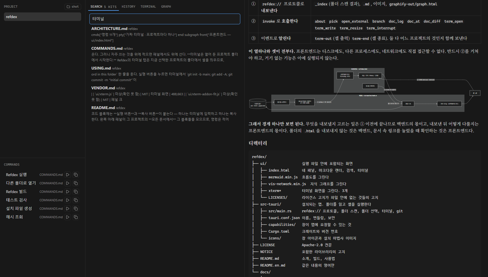

# Refdex

[한국어](README.md) · **English**

**Refdex reads the markdown in your project folders — all of it, on one screen.** One HTML page in a
window on Windows, with Rust behind it reading the folder you chose and handing it over. No server,
no database, no account, and nothing written back into your folders.



> The documents under `docs/` are written in Korean. This page is the English one.

## What it does

Point it at the folder that holds your projects, and **every folder under it with a `.md` in it
becomes a project.** No marker file, nothing to register. Pick one and its front document opens on
the right; from there you move by **following the links inside the documents**. There is no file list
on screen — the list belongs in a document. What is where is better said in writing, and then the
same path is visible whether it is read in an editor or on GitHub.

The middle pane holds four tabs.

| Tab | What it does |
| :--- | :--- |
| **Search** | The text and path of every document. ↓↑ to mark, Enter to open |
| **History** | That document's git record. The commit message in full with the changed lines beneath. **A document that no longer exists opens as it stood** |
| **Terminal** | A real shell **per project**, opened in that project's folder |
| **Graph** | Embeds `graphify-out/graph.html` if the project has one, and says so if it does not |

Shell code blocks in a document carry a **run** and a **copy** button — one types the block into the terminal, the
other copies it. The bottom-left pane gathers those blocks from **every document** in the project, so
a command is both where you wrote it down and in one list.

Edit a `.md` in your editor and **the screen catches up within three seconds**, keeping the place you
were reading.

## Running it

You need [Rust](https://rustup.rs) and Windows 11. WebView2 ships with Windows 11.

```text
cargo run --manifest-path src-tauri/Cargo.toml
```

The first run takes a few minutes fetching crates; after that, a few seconds. Building just the
executable, or the installer, is in [COMMANDS](docs/COMMANDS.md) (Korean).

**The shipped form is one `.msi`**, installing to `C:\Program Files\Refdex`. For portable use, one
`refdex.exe` is enough — the screen is inside the executable, so there is nothing to keep beside it.
There is no signature; a `SHA-256` is published beside the file
([D35](docs/ARCHITECTURE.md)).

## Pointing it at a folder

**The app writes the folder down nowhere.** Two ways:

- **Put it in a shortcut** — at the end of the target, and pressing it opens straight into that folder
- **Pick it in the window** — opened with no argument, the door screen lets you pick. What you pick
  lives in that window only

```text
refdex.exe "D:\Projects"
```

What you point at is **the folder holding your projects**, not one project. How a folder should be
laid out is in [USING](docs/USING.md) (Korean).

## What it does not do

This is version `1.0.0`'s line. Not left out — **decided against** ([D48](docs/ARCHITECTURE.md)).

- **It does not edit.** That is your editor's job; Refdex opens, reads and closes
- **It does not change your repository.** It reads the record and shows which branch you are on; it
  creates, switches and merges nothing. That belongs to the terminal right below
- **It has no AI pane.** Not in this version
- **Windows only.** Mac and Linux have never been run ([D37](docs/ARCHITECTURE.md))
- **It writes nothing to disk** — not the folder it reads, not a settings place of its own. Only the
  pane widths stay, in the browser's `localStorage`

## How it is built

In order of what gets sacrificed first: **fewest dependencies → read only → one file**.

| Principle | How it shows |
| :--- | :--- |
| **Fewest dependencies** | Three vendored files — `mermaid.min.js`, `xterm*`, `vis-network.min.js`. No CDN, no package manager, no framework, no bundler |
| **Read only** | The back end serves bytes; editing belongs to an editor. Several decisions hold this line together |
| **One file** | The screen, the renderer, search and the terminal are all in `ui/index.html`. It gets split when it stops being readable |

| Part | What it does | Built with |
| :--- | :--- | :--- |
| `ui/index.html` | Four panes, markdown, links, search, terminal | HTML, CSS, JS — no build step |
| `src-tauri/` | Reads the chosen folder, runs the shell, calls git | Rust, Tauri, WebView2, portable-pty |

**The screen having no build step is deliberate** ([D21](docs/ARCHITECTURE.md)) — the line you edit is
the line that runs. Only the app shell is built, and `ui/` goes inside the executable, so seeing a
change in the app means building again.

## Documents

They are in Korean.

| Document | What is in it |
| :--- | :--- |
| [USING](docs/USING.md) | Choosing a folder, laying one out, using the four panes and the tabs |
| [ARCHITECTURE](docs/ARCHITECTURE.md) | Front end and back end, the directory tree, how documents are read in, **the decision record** |
| [COMMANDS](docs/COMMANDS.md) | Build and release commands |
| [VENDOR](docs/VENDOR.md) | Versions and licences of what is vendored |

Refdex is not needed to read them — an editor or GitHub shows the same path. That is why **the path
lives in the documents, not in the screen** ([D11](docs/ARCHITECTURE.md)).

## Licence

Apache-2.0. The full text is in `LICENSE`; notices for what is vendored are in `NOTICE` and
`ui/LICENSES/`.
