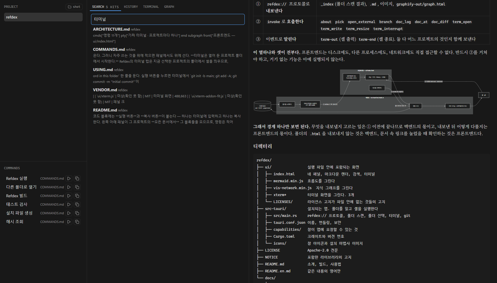

# Refdex

**한국어** · [English](README.en.md)

**Refdex는 내 프로젝트들의 문서를 한 화면에서 읽는다.** 윈도우에서 앱으로 뜨는 HTML 한 장이고, 뒤에서 Rust가 고른 폴더를 읽어 건넨다. 서버도 데이터베이스도 계정도 없고, 읽는 폴더에는 아무것도 쓰지 않는다.



## 무엇을 하나

프로젝트들이 들어 있는 폴더를 가리키면, 그 아래에서 **`.md`를 가진 폴더가 모두 프로젝트가 된다.** 표시해 둘 파일도, 등록할 자리도 없다. 프로젝트를 고르면 메인 문서가 오른쪽에 뜨고, 그다음부터는 **문서 안의 링크를 눌러** 옮겨 간다. 화면에 파일 목록은 두지 않는다 — 목록은 문서가 쥔다. 무엇이 어디 있는지는 문서에 적는 편이 낫고, 그래야 편집기로 읽든 GitHub으로 읽든 같은 길이 보인다.

가운데 패널에 탭이 넷이다.

| 탭 | 무엇을 하나 |
| :--- | :--- |
| **Search** | 모든 문서의 본문과 경로를 훑는다. ↓↑로 짚고 Enter로 연다 |
| **History** | 그 문서의 커밋 기록. 메시지 전문을 펼치고 그 아래에 바뀐 줄을 세운다. **지금 없는 문서도 그 시점 모습으로 열린다** |
| **Terminal** | **프로젝트마다 하나씩** 열리는 진짜 셸. 그 프로젝트 폴더에서 시작한다 |
| **Graph** | 그 프로젝트에 `graphify-out/graph.html`이 있으면 끼워 넣고, 없으면 없다고 적는다 |

문서 속 셸 코드 블록에는 **실행 버튼**과 **복사 버튼**이 붙는다 — 하나는 터미널에 입력하고 하나는 복사한다. 왼쪽 아래 패널이 그 프로젝트의 **모든 문서에서** 그 블록들을 모으므로, 명령은 적어 둔 자리에도 있고 한 목록에도 있다.

편집기로 `.md`를 고치면 **3초 안에 화면이 따라온다.** 읽던 자리도 그대로다.

## 받아서 돌리기

필요한 것은 [Rust](https://rustup.rs)와 윈도우 11이다. WebView2는 윈도우 11에 깔려 온다.

```text
cargo run --manifest-path src-tauri/Cargo.toml
```

처음 한 번은 크레이트를 받느라 몇 분 걸리고, 그다음부터는 몇 초다. 실행 파일만 뽑거나 설치본을 만드는 줄은 [COMMANDS](docs/COMMANDS.md)에 있다.

**배포 형식은 `.msi` 하나**이고 `C:\Program Files\Refdex`에 깔린다. 들고 다니려면 `refdex.exe` 하나만 있으면 된다 — 화면이 실행 파일 안에 들어 있어 옆에 둘 파일이 없다. 서명은 붙이지 않고 `SHA-256`을 파일과 나란히 적는다([D35](docs/ARCHITECTURE.md)).

## 폴더를 가리키는 법

**앱은 읽을 폴더를 어디에도 저장하지 않는다.** 두 길이 있다.

- **바로가기에 붙인다** — 대상 끝에 폴더를 적어 두면 누르는 순간 거기로 선다
- **창에서 고른다** — 인자 없이 실행하면 시작 화면에서 고른다. 고른 폴더는 그 창에서만 유지된다

```text
refdex.exe "D:\Projects"
```

가리키는 것은 **프로젝트 하나가 아니라 그것들이 담긴 폴더**다. 폴더가 어떻게 생겨야 하는지는 [USING](docs/USING.md)에 있다.

## 무엇을 안 하나

버전 `1.0.0`의 선이다. 빠뜨린 것이 아니라 **두지 않기로 한 것**이다([D48](docs/ARCHITECTURE.md)).

- **고치지 않는다.** 그것은 편집기의 일이고 Refdex는 열어서 읽고 닫는다
- **저장소를 수정하지 않는다.** 커밋 기록을 읽고 지금 어느 브랜치인지 보여 줄 뿐, 브랜치를 만들지도 옮기지도 않는다. 그 일은 바로 아래 터미널의 몫이다
- **AI 패널이 없다.** 이 버전에는 두지 않았다
- **윈도우만 겨눈다.** 맥·리눅스는 돌려 본 적이 없다([D37](docs/ARCHITECTURE.md))
- **디스크에 아무것도 쓰지 않는다.** 읽을 폴더도, 자체 설정 폴더도. 패널 너비만 브라우저의 `localStorage`에 남는다

## 어떻게 만들었나

우선순위는 **의존성 최소 → 읽기만 → 한 파일** 순이다.

| 원칙 | 어떻게 보이나 |
| :--- | :--- |
| **의존성 최소** | 포함한 파일은 셋뿐이다 — `mermaid.min.js`, `xterm*`, `vis-network.min.js`. CDN도 패키지 매니저도 프레임워크도 번들러도 없다 |
| **읽기만** | 백엔드는 파일을 내보내기만 하고, 수정은 편집기가 한다. 결정 여럿이 이 선을 함께 지킨다 |
| **한 파일** | 화면·렌더러·검색·터미널이 `ui/index.html` 하나에 있다. 읽기 힘들어지면 그때 나눈다 |

| 자리 | 무엇을 하나 | 무엇으로 |
| :--- | :--- | :--- |
| `ui/index.html` | 네 패널, 마크다운 렌더, 링크, 검색, 터미널 | HTML·CSS·JS — 빌드 단계가 없다 |
| `src-tauri/` | 지정한 폴더를 읽어 전달하고, 셸을 실행하고, git을 호출한다 | Rust·Tauri·WebView2·portable-pty |

**화면 쪽에 빌드 단계를 두지 않는 것은 일부러다**([D21](docs/ARCHITECTURE.md)) — 고친 줄이 곧 도는 줄이다. 빌드하는 것은 앱 껍데기뿐이고, `ui/`는 실행 파일 안에 들어가므로 앱에서 보려면 다시 빌드한다.

## 문서

| 문서 | 무엇이 들어 있나 |
| :--- | :--- |
| [USING](docs/USING.md) | 폴더 지정, 폴더 구조, 네 패널과 탭 사용법 |
| [ARCHITECTURE](docs/ARCHITECTURE.md) | 프론트엔드와 백엔드, 디렉터리 트리, 문서를 읽어 들이는 순서, **결정 기록** |
| [COMMANDS](docs/COMMANDS.md) | 빌드와 배포 명령 |
| [VENDOR](docs/VENDOR.md) | 포함한 라이브러리의 버전과 라이선스 |

문서를 읽는 데 Refdex가 필요하지는 않다 — 편집기로 열어도, GitHub에서 읽어도 같은 길이 보인다. 그게 **길을 화면이 아니라 문서에 두는** 까닭이다([D11](docs/ARCHITECTURE.md)).

## 라이선스

Apache-2.0. 전문은 `LICENSE`에, 포함한 라이브러리의 고지는 `NOTICE`와 `ui/LICENSES/`에 있다.
