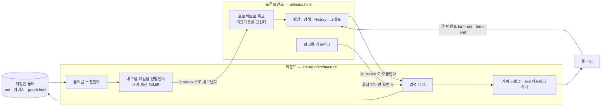
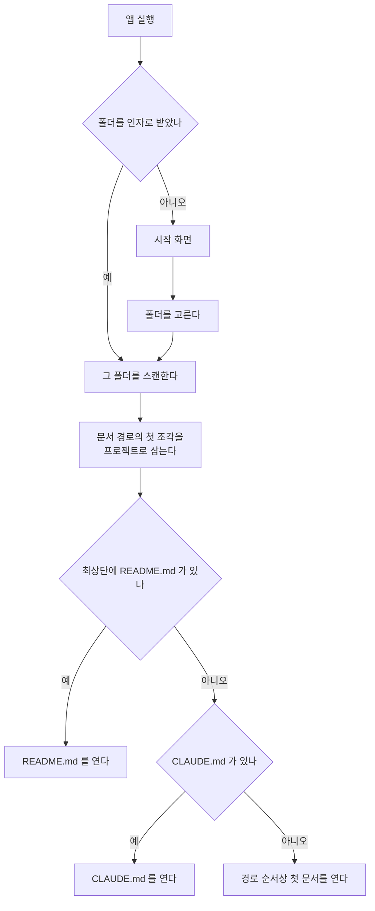

# 아키텍처

[README](../README.md) / `docs` — [ARCHITECTURE](ARCHITECTURE.md) · [USING](USING.md) · [COMMANDS](COMMANDS.md) · [VENDOR](VENDOR.md)

Refdex의 전체 구조와 경계를 정의한다. **디렉터리 트리는 이 문서에만 둔다.** 다른 문서는 여기를 링크한다.

## 이름

| 이름 | 뜻 | 범위 |
| :--- | :--- | :--- |
| **Refdex** | 내 프로젝트들의 문서를 한 화면에서 읽는 HTML 한 장 | `index.html`과 이 저장소의 문서까지다. 다른 프로젝트와 그 `.md`는 Refdex의 것이 아니다 |
| **프로젝트** | 지정한 폴더 바로 아래의, 읽을 문서가 있는 폴더 하나 | 문서가 있는 곳이 프로젝트가 되는 곳이다 |

## 계층

```text
사용자 — 폴더를 지정한다
    │
ui/index.html — 읽어서 네 패널에 그린다
    │
각 프로젝트의 .md 와 graphify-out/graph.html
```

아래로만 흐른다. Refdex는 아래에 아무것도 쓰지 않는다.

## 프론트엔드와 백엔드

앱은 두 부분이고 프로세스가 다르다. **백엔드는 외부에 접근하고, 프론트엔드는 받은 것만 다룬다.** 고칠 위치를 찾을 때와 무엇이 무엇을 막는지 볼 때 이 경계부터 본다.

| | 담당 |
| :--- | :--- |
| **백엔드** `src-tauri/src/main.rs` | 폴더 스캔. 내보낼 파일 선별(`D33`). 크기 제한(`D36`). 폴더 선택 창. 외부 브라우저로 넘기기. `git` 호출. 셸 실행과 중단(`D24` `D26`). 창 생성과 페이지 고정(`D33`). 버전 보고 |
| **프론트엔드** `ui/index.html` | 받은 목록을 프로젝트로 묶기(`D34`). 마크다운 렌더. 검색(`D32`). 패널 측정과 경계 이동(`D20`). 링크 가로채기(`D33`). 명령 수집(`D10`). 키보드 이동(`D38`) |

주고받는 경로는 셋뿐이다.

| | 방식 | 내용 |
| :--- | :--- | :--- |
| ① | `refdex://` 프로토콜로 **내보낸다** | `_index`(폴더 스캔 결과), `.md`, 이미지, `graphify-out/graph.html` |
| ② | `invoke`로 **호출한다** | `about` `pick` `open_external` `branch` `doc_log` `doc_at` `doc_diff` `term_open` `term_write` `term_resize` `term_interrupt` |
| ③ | 이벤트로 **알린다** | `term-out`(셸 출력) `term-end`(셸 종료). 둘 다 어느 프로젝트의 것인지 함께 보낸다 |

**이 열하나와 셋이 전부다.** 프론트엔드는 디스크에도, 다른 프로세스에도, 네트워크에도 직접 접근할 수 없다. 반드시 ②를 거쳐야 하고, 거기 없는 기능은 아예 실행되지 않는다.



**그래서 경계 하나만 보면 된다.** 무엇을 내보낼지 고르는 일은 ① 이전에 끝나므로 백엔드의 몫이고, 내보낸 뒤 어떻게 다룰지는 프론트엔드의 몫이다. 폴더의 `.html`을 내보내지 않는 것은 백엔드, 문서 속 링크를 눌렀을 때 확인하는 것은 프론트엔드다.

## 디렉터리

```text
refdex/
├── ui/                 실행 파일 안에 포함되는 화면
│   ├── index.html      네 패널, 마크다운 렌더, 검색, 터미널
│   ├── mermaid.min.js  흐름도를 그린다
│   ├── vis-network.min.js  지식 그래프를 그린다
│   ├── xterm*          터미널 화면을 그린다. 3개
│   └── LICENSES/       라이선스 고지가 파일 안에 없는 것들의 고지
├── src-tauri/          설치되는 앱. 폴더를 읽고 셸을 실행한다
│   ├── src/main.rs     refdex:// 프로토콜, 폴더 스캔, 폴더 선택, 터미널, git
│   ├── tauri.conf.json 이름, 번들링, 보안
│   ├── capabilities/   창이 앱에 요청할 수 있는 것
│   ├── Cargo.toml      크레이트와 버전 번호
│   └── icons/          창 아이콘과 설치 마법사 이미지
├── LICENSE             Apache-2.0 전문
├── NOTICE              포함한 라이브러리의 고지
├── README.md           소개, 빌드, 사용법
├── README.en.md        같은 내용의 영어판
└── docs/
    ├── ARCHITECTURE.md 이름, 계층, 디렉터리 트리, 결정 기록
    ├── USING.md        사용법, 폴더 구조
    ├── COMMANDS.md     빌드와 배포 명령
    └── VENDOR.md       포함한 라이브러리의 버전과 라이선스
```

## 문서를 읽어 들이는 순서



1. 앱이 실행된다. 읽을 폴더는 인자로 받거나 창에서 고른다. 그 폴더는 앱 자체 프로토콜로만 전달되고 외부로 나가지 않는다.
2. 페이지가 `/_index`를 요청한다. 백엔드가 폴더를 스캔해 `.md` 목록과 마지막 수정 시각, 이미지 목록, 프로젝트별 그래프 경로를 돌려준다.
3. 백엔드가 내보내는 것은 **`.md`와 이미지, 그리고 `graph.html` 하나뿐**이다(2026-11-21). 빌드 산출물과 형상관리 폴더는 **들어가기 전에** 건너뛴다 — `.git` `.hg` `.svn` `.obsidian` `node_modules` `target` `build` `dist` `bin` `obj` `vendor` `__pycache__` `.venv` `venv` `.next` `.nuxt`.
4. 문서가 있는 **바로 아래** 폴더를 **프로젝트**로 삼는다 — 문서 경로의 첫 조각이다. 더 깊은 `docs/`는 별도 프로젝트가 되지 않는다.
5. 프로젝트를 고르면 최상단의 `README.md`, 없으면 `CLAUDE.md`, 둘 다 없으면 **첫 문서**를 연다.

**3초마다 `/_index`를 다시 받아 이전과 비교한다.** 내용이 바뀐 것도, 파일이 늘거나 줄어든 것도 그 한 번으로 감지하고 **읽던 위치를 유지한 채** 다시 그린다(2026-11-21).

문서를 그린 뒤 세 가지를 보정한다. mermaid 블록은 그림으로 바꾸고, 상대 경로 이미지는 앱 프로토콜 주소로 바꾸고, `.md` 링크는 클릭을 가로채 오른쪽 패널에 띄운다. 폴더 안에 없는 이미지는 대괄호 글자로 남고, 갈 곳 없는 링크는 **주소를 제거해** 글자로 남는다(2026-11-21).

## 막아 둔 것

- **크기 제한 64MiB.** 읽는 쪽이 파일을 통째로 메모리에 올리므로 그보다 크면 내보내지 않고 너무 크다고 표시한다(2026-11-21)
- **콘텐츠 보안 정책.** 스크립트는 앱 자체 출처의 것만 실행된다. 문서를 그리다 끼어든 글은 스크립트가 되지 못한다 — 실제로 넣어 보고 실행되지 않는 것을 확인했다(2026-11-21)
- **창은 자기 페이지를 떠나지 못한다.** 링크 가로채기와 별개로 한 번 더 막는다(2026-11-21)
- **끼워 넣은 그래프는 별도 출처를 받는다.** 앱에 아무것도 요청할 수 없다(2026-11-19)

## 바탕에 기대는 것

| 기능 | 용도 | 없으면 |
| :--- | :--- | :--- |
| 앱 자체 프로토콜 | 문서와 이미지, `graph.html` 전달 | 아무것도 뜨지 않고 시작 화면이 선다 |
| CSS 그리드 | 네 패널 배치 | 패널이 세로로 쌓인다 |
| `localStorage` | 조절한 패널 너비 저장 | 열 때마다 기본 너비 |
| `mermaid.min.js` | ` ```mermaid ` 블록을 그림으로 | 그림이 글자로 남는다 |
| `xterm*` | 터미널 화면 | 터미널 탭만 이유를 표시하고 멈춘다 |
| `vis-network.min.js` | 지식 그래프 | 그래프 탭만 비어 있다 |
| `git` | 커밋 기록 읽기 | History 탭이 이유를 표시하고 멈춘다 |
| WebView2 · 셸 | 창과 터미널 | [VENDOR](VENDOR.md)에 있다 |

## 결정 기록

`코드` 열: ✓ 반영됨, — = 코드와 무관. 더는 쓰지 않는 결정은 지우되, 그 이유는 대신 선 결정으로 한 줄 옮긴다 — 이유가 사라지면 나중에 같은 논쟁을 다시 한다.

| # | 결정 | 이유 | 코드 |
| :--- | :--- | :--- | :---: |
| D1 | 이름은 **Refdex** — reference(참고)와 index(색인)에서 왔다 | 하는 일이 그것이다: 가진 문서를 늘어놓고, 찾고, 가리킨다. 처음 이름은 `Wiki`였는데 그 단어는 어디에나 있어서 자기 것이 되지 못한다 — `Program Files\Wiki`도, `wiki.exe`도, 검색 결과도 남의 것과 섞인다. 책이 아니라 **문서**를 다루므로 `Docket`·`Codex` 같은 책 쪽 이름은 피했고, 찾아보니 `Docket`은 쓰는 곳이 많고 `Docdex`는 같은 자리(문서 색인 도구)에 이미 있었다. `Refdex`는 소프트웨어로 쓰이는 곳이 없다(2026-11-22). 바꾼 곳은 넷이다 — 크레이트 이름, 창과 설치 파일의 이름, 식별자(`local.refdex`), 폴더를 내보내는 프로토콜(`refdex://`) | ✓ |
| D2 | 의존성을 늘리지 않는다 | 브라우저가 폴더 선택과 텍스트 읽기를 이미 제공한다. CDN을 쓰면 오프라인에서 열리지 않는다 | ✓ |
| D3 | 내용은 각 프로젝트의 `.md`가 쥔다 | Refdex가 사본을 두면 둘이 어긋나고, 어느 쪽이 맞는지 알 수 없게 된다 | ✓ |
| D5 | 데이터베이스도 검색 인덱스도 두지 않는다 | 문서 전체가 한 번에 메모리에 들어간다. 그 규모에서 인덱스는 이득이 아니라 손해다 | ✓ |
| D6 | 프로젝트 목록을 설정 파일로 두지 않는다 | 지정한 폴더 바로 아래에서 읽을 문서가 있는 폴더가 프로젝트다(`D34`). 목록을 따로 적어 두면 프로젝트가 늘 때마다 두 곳을 고쳐야 한다 | ✓ |
| D7 | 마크다운 렌더러를 직접 구현한다 | 문서가 쓰는 것은 제목·표·목록·인용·코드·링크뿐이다. 그만큼이면 라이브러리를 들이는 것보다 짧다. 직접 구현하는 대신 지켜야 하는 선이 하나 있다 — **문서는 글이고 코드가 아니다.** 꺾쇠와 따옴표를 원본에서 한 번 치환하고, `javascript:`처럼 누르면 실행되는 링크 대상은 버려 글자로 남긴다. 주석은 지운다 — 다른 렌더러가 모두 지우는 것이고, 이스케이프만 하면 개발자에게 쓴 글이 사용자 화면에 그대로 나온다. 이 페이지는 그 폴더에 셸을 띄울 수 있으므로, 문서 한 줄이 여기서 실행되는 것은 폴더를 읽는 것과 무게가 다르다 | ✓ |
| D8 | 이전 내용을 보관하지 않는다 | 문서에는 지금 맞는 것만 둔다. 필요해지면 그때 만든다 | — |
| D9 | graphify 결과는 그대로 끼워 넣는다 | `graph.html`은 서버 없이 열리도록 만들어진 파일이라 그대로 전달하면 된다 — 그래프를 다시 그리는 코드를 Refdex에 두면 같은 일을 두 번 한다. 끼워 넣을 때는 **별도 출처**를 받게 한다. 그 파일은 읽기만 하겠다고 한 폴더에서 오는데, 앱 자체 프로토콜로 전달하면 앱에 요청할 수 있는 권한까지 함께 받아 그 폴더에 셸을 띄우고 아무 글자나 입력할 수 있다. 출처를 떼면 그 경로가 막히고 그림은 그대로 그려진다. 그대로 끼운다는 것에서 **둘은 예외다.** 하나는 라이브러리다 — 그 페이지는 그리기 라이브러리를 CDN에서 받아 오는데 이 앱은 외부로 나가지 않으므로, 같은 버전을 포함해 두고 내보낼 때 그 태그만 우리 것으로 바꾼다. `integrity`와 `crossorigin`은 함께 제거한다. 그 해시는 CDN 복사본의 것이고, 우리가 직접 내보내는 파일에 CORS를 요구하면 요청이 거절되어 라이브러리가 끝내 오지 않는다. 디스크의 파일은 건드리지 않고 내보내는 내용만 바뀐다. 둘은 **테마 기본값**이다. 그 페이지에는 `Light` `Dark` `System` 버튼이 있고 아무것도 고르지 않으면 OS와 무관하게 어두운 쪽으로 선다. 이 앱은 OS를 따라가므로(`D44`), 밝은 창 안에 어두운 그래프가 서면 한 앱이 두 말을 하는 셈이다. 그래서 내보낼 때 **그 페이지의 `System` 버튼을 누르는 줄 하나**를 덧붙인다 — 색을 고쳐 쓰지 않고 그 페이지가 자기 방식으로 OS를 묻게 한다. 그 버튼이 없는 버전은 그대로 나간다. **OS 테마가 바뀔 때마다 다시 누른다.** 그 프레임은 출처 없이 전달되므로 저장소를 쓸 수 없는데, 그 페이지는 고른 값을 저장소에 두고 자기 테마 감시자가 그것을 읽어 본 뒤에 움직인다 — 여기서는 읽을 것이 없으니 아무 일도 하지 않는다. 게다가 그 프레임은 창의 테마가 닿기 전 한순간 밝다고 답하는데, 첫 클릭이 그 순간에 걸린다. 두 번째 클릭이 없으면 어두운 창이 밝은 그래프를 안고 있게 된다 — 실제로 그랬다. **다만 `System`이 선택된 동안에만 다시 누른다.** 그 페이지에서 `Light`나 `Dark`를 고른 사용자는 OS와 무관하게 그것을 보겠다고 말한 것이고, 그 밑에서 `System`을 다시 누르면 OS 테마가 바뀌는 순간 선택을 빼앗게 된다. 고른 값은 그 페이지가 버튼에 표시해 두므로 그것을 보고 비킨다. 네 경우를 차례로 측정해 확인했다 — 아무것도 고르지 않으면 OS를 따라가고, `Light`를 고르면 OS를 두 번 뒤집어도 밝은 채로 있고, 다시 `System`을 고르면 그때부터 또 따라온다(2026-11-22) | ✓ |
| D10 | **명령은 문서의 코드 블록이다.** 왼쪽 아래 패널은 그 프로젝트의 **모든 문서**에서 셸 블록을 모은다 — 등록하는 곳도, 이름이 정해진 파일도 없다 | 명령이 이미 문서에 적혀 있다. 그것을 다른 패널로 옮겨 적으면 같은 것이 두 곳에 있게 되고, 옮길 곳을 정하려면 이름이 정해진 파일이 하나 필요해진다 — 그 파일은 Refdex만을 위해 두는 것이 되어, 읽을 폴더에 Refdex의 흔적을 요구한다(`D22`). 그래서 **블록이 제자리에서 실행되고**, 패널은 그 블록들을 모아 보여 주기만 한다. 명령을 만드는 일은 `.md`에 코드 블록을 쓰는 일이고, 어느 문서의 어디에 써도 패널에 올라온다. 패널을 없애지 않은 것은 읽고 있는 문서가 무엇이든 명령은 손에 있어야 하기 때문이다. 실행 가능한 블록인지는 **블록의 언어**가 판별한다 — 셸 언어면 올라오고, `text`면 올라오지 않는다. 선택하고 싶으면 언어를 바꾸면 되니 등록 목록이 따로 필요 없다. 그리고 실행 버튼은 **마지막 Enter를 누르지 않는다** — 한 번 누르면 실행되는 것이 모든 문서의 모든 블록으로 늘어났으므로, 남이 쓴 `.md`도 읽을거리로만 다룬다는 선(`D33`)이 여기서 지켜져야 한다. 입력된 글자가 터미널에 그대로 기다리고, Enter는 사용자가 누른다. 블록이 그 Enter까지 가져가려면 마지막에 빈 줄을 두면 된다 | ✓ |
| D11 | **앱은 디렉터리 목록을 내보내지 않는다.** 문서는 목록으로 나열하지 않고 링크로 이동한다 | 프로젝트의 메인 문서에서 시작해 문서 안의 링크를 눌러 이동한다. 폴더를 나열하면 어떤 확장자를 보여 줄지 사용자가 정해 줘야 하는데 그 답이 프로젝트마다 다르고, 목록이 길어지면 왼쪽 패널이 파일 탐색기가 된다. 링크로 이동하면 문서가 스스로 자기 범위를 말한다. 검색 패널을 디렉터리로 쓰는 방법도 있었다 — 입력창이 비었을 때 그 프로젝트의 문서를 폴더별로 세우면 패널도 탭도 늘지 않고 디스크에서 매번 읽으니 뒤처질 수도 없다. 그래도 두지 않는다. **디렉터리를 앱이 쥐면 그 폴더의 문서들은 Refdex 안에서만 경로가 보이게 된다** — 편집기나 GitHub으로 읽는 사람에게는 그 경로가 없다. 경로를 문서에 두면 어디서 읽든 같다(`D12`) | ✓ |
| D12 | 메인 문서는 `README.md`고, 없으면 `CLAUDE.md`, 둘 다 없으면 경로 순서상 첫 문서를 연다. **모든 문서가 제목 아래 상단 링크 줄 하나를 둔다 — 지금 폴더와 그 안의 이웃뿐이다** | 목록을 화면이 아니라 문서가 쥔다. 그래야 Refdex를 거치지 않고 편집기나 GitHub으로 읽어도 같은 경로가 보인다. Refdex가 목록을 만들어 주지는 않는다 — 그러면 화면에서 덜어낸 파일 목록이 문서 자리에 그대로 되살아난다. `CLAUDE.md`를 뒤에 두는 것은 규칙 문서라 링크가 적기 때문이다. 맨 위 줄에 **저장소 전체 목록을 적지는 않는다.** 그렇게 해 봤더니 짧은 문서에서는 링크 줄이 본문보다 길고, 여러 곳에 같은 목록이 살아 한 곳만 빠뜨려도 거짓말을 한다. 다른 문서 체계들도 그렇게 하지 않는다 — 전체 목록은 본문 **옆**이나 **끝**에 두고, 맨 위에는 **지금 어디인지**만 둔다(위키백과의 navbox는 문서 맨 아래가 표준이고, 문서 생성기들은 그 목록을 사이드바가 쥔다). 그래서 맨 위에는 **지금 폴더와 그 안의 이웃**만 적는다. 폴더 이름을 그대로 쓰는 것은, 지어낸 분류는 적은 사람에게만 의미가 있고 읽는 사람에게는 한 겹 더 풀어야 할 것이 되기 때문이다. **줄이 길어지면 폴더를 나눈다** — 한 폴더가 여덟을 넘기면 줄을 줄일 것이 아니라 그 폴더가 너무 많은 일을 한다는 신호로 읽는다. 링크에 설명을 붙이지 않는 것도 같은 이유다 — 설명은 한 폴더 안에서 여러 번 적히고, 역할이 바뀔 때 그만큼 어긋난다. 무엇이 들어 있는지는 README의 문서 표 한 곳이 쥔다 | ✓ |
| D14 | 그리는 일은 포함한 라이브러리에 맡긴다 | 그림도 터미널도 직접 그리면 레이아웃 계산과 ANSI 해석을 통째로 다시 만드는 일이다. 포함한 것은 셋이다 — `ui/mermaid.min.js`가 흐름도를, `ui/xterm*` 셋이 터미널 화면을, `ui/vis-network.min.js`가 지식 그래프를 그린다. 버전과 라이선스는 [VENDOR](VENDOR.md)에 있다. 마지막 것은 우리 화면이 부르지 않고 `D9`대로 끼워 넣는 페이지에 전달된다. 파일을 옆에 두면 CDN 없이 오프라인에서 열린다는 `D2`의 이유는 그대로 지켜지고, 해당 탭을 처음 열 때만 불러오므로 평소에는 읽지도 않는다 | ✓ |
| D15 | 앞뒤로 이동하는 버튼을 두지 않는다 | 이동 경로는 문서에 적힌 링크다. 상단 링크 줄이 메인 문서로 가고, 그다음은 그 문서가 가리키는 곳으로 간다. 버튼을 두면 같은 일을 하는 경로가 둘이 되고, 그중 하나는 문서를 편집기로 읽을 때 없다. 화면이 경로를 만들기 시작하면 문서는 자기 경로를 적을 이유를 잃는다 | ✓ |
| D19 | 노드가 많은 그래프도 패널에 그대로 끼워 넣는다 | 노드 950개짜리를 띄워도 Refdex가 버틴다. 걱정했던 것은 레이아웃 계산이 이 탭의 스레드를 잡는 일이었는데, 측정해 보니 사용에 지장이 없었다 | ✓ |
| D20 | 패널 경계를 드래그해 조절하고 그 너비를 이 브라우저에 저장한다 | 세로 둘은 열의 너비를, 가로 하나는 왼쪽 열의 높이를 나눈다. 알맞은 너비는 사용자마다 다르다. 저장할 곳은 `localStorage`뿐이다 — 서버에 두면 기계가 달라도 같은 너비가 되어 오히려 틀리고, 파일로 두면 이 기계의 사정이 저장소에 섞인다. 읽지 못하거나 깨져 있으면 조용히 기본값으로 돌아간다. 너비는 픽셀로 저장되므로 불러올 때와 창 크기가 바뀔 때마다 지금 창에 맞게 다시 조인다 — 넓은 창에서 저장한 너비를 좁은 창에 그대로 적용하면 문서 패널이 창 밖으로 나가고, 그것을 되돌릴 경계까지 함께 나가 손쓸 수 없게 된다. 최소 너비는 취향이 아니라 측정해서 정한다 — 문서 패널은 이 저장소의 문서를 그려 보고 표가 옆으로 넘치지 않는 너비로 잡았고, 셋을 합친 값이 창이 작아질 수 있는 한계가 되므로 창 자체의 최소 크기도 거기에 맞춘다. 그리고 창 자체에는 스크롤을 두지 않는다. 글이 넘치면 그 패널 안에서 스크롤되는 것이 맞고, 창이 스크롤된다는 것은 패널이 창과 맞지 않는다는 뜻이다 | ✓ |
| D21 | 설치되는 앱은 Tauri로 만든다 | 브라우저 탭 안에서는 늘 대가를 치렀다 — 열 때마다 폴더를 고르거나, 가끔 권한을 받거나, 빌드 시점의 내용을 보거나, 조용히 깨지는 목록 파싱에 기대야 했다. 설치되는 앱은 그 넷을 한꺼번에 없앤다. 화면은 HTML을 그대로 쓰고 Rust가 폴더를 읽어 자체 프로토콜로 전달한다 — 화면을 네이티브로 다시 그리면 mermaid와 graphify의 `graph.html`을 같이 버리게 되므로 웹뷰는 피할 수 없고, Electron은 크로미움을 통째로 품고 다녀 오히려 무겁다. 앱 안에서 전달하므로 포트도, 주소도, 숨겨야 할 콘솔 창도 없다. 터미널과 git 패널에 필요한 프로세스 제어가 자연스럽고 맥·리눅스로도 넓힐 수 있다. 대가는 빌드 단계가 생기는 것과 유지에 Rust를 읽을 수 있어야 한다는 것이다 | ✓ |
| D22 | 읽을 폴더는 실행할 때 인자로 받거나 창에서 고르고, 앱은 어디에도 저장하지 않는다. **시작 화면은 잘못됐을 때만 말한다** | 설치되는 앱은 설치 위치에 있어 프로젝트 폴더가 어디인지 알 길이 없다. 그래서 실행할 때 인자로 받거나 OS 대화상자로 고른다 — 바로가기 하나가 곧 설정이고, 그것은 눈에 보이고 사용자가 오른쪽 버튼으로 고칠 수 있다. 앱이 자체 설정 폴더에 저장하는 방법도 있었지만, 숨은 위치에 생기는 파일은 사용자가 찾지 못하면서 지워지지도 않는다. 프로젝트 폴더 안에 설정 폴더를 심는 것은 더 아니다 — **읽기만 한다**는 선을 Refdex가 먼저 넘는다. 폴더가 없을 때 만들어 주지도 않는다. 패널 너비는 여기 딸려 오지 않는다 — 그것은 `D20`대로 `localStorage`에 남는다. **시작 화면에는 상태를 적는 줄을 두지 않는다** — "열린 폴더가 없다"는 그 위 버튼이 이미 하는 말이고, 같은 말을 두 번 하면 정작 잘못됐을 때 쓸 자리가 없다. 그 자리는 **이유가 있을 때만** 버튼 아래에 선다: 실행할 때 받은 경로가 폴더가 아니면 그 경로를 그대로 적고, 읽던 폴더가 사라지면 사라졌다고 적는다(`D45`) | ✓ |
| D23 | 가운데는 탭 하나짜리 패널이고 선택한 탭이 전체를 쓴다 | 가운데는 고르는 곳이 아니라 작업하는 곳이다. 그래프와 검색이 위아래로 나눠 가졌더니 그래프는 세로로 잘리고 검색은 몇 줄만 보였다 — 좁은 패널을 둘로 나눈 탓이다. 거기에 터미널·git·AI까지 들어오면 넷을 쌓을 수 없다. 탭 이름을 늘 보이게 두면 무엇이 있는지는 보이므로 누르는 단계가 생겨도 숨기는 것이 아니다. 어느 탭이었는지는 저장하지 않는다 — 앱이 아무것도 저장하지 않는다는 것과 같은 줄기다 | ✓ |
| D24 | 터미널은 가짜 터미널 위의 진짜 셸이고, **프로젝트마다 하나씩이다** | 파이프로만 연결하면 셸이 출력을 파일로 보낸다고 판단해 프롬프트도 히스토리도 색도 끈다. 입력해도 아무것도 안 보이는 창이 된다. 그래서 백엔드는 `portable-pty`로 가짜 터미널을 두고 프론트엔드는 `xterm.js`가 그린다 — 둘은 고를 수 있는 선택지가 아니라 한 쌍의 앞뒤다. 셸은 **선택한 프로젝트의 폴더**에서 열리고 사용자가 평소 쓰는 셸을 쓴다. 프로젝트마다 하나씩인 이유는 가운데 패널의 나머지가 이미 전부 프로젝트의 것이기 때문이다 — 검색도 커밋 기록도 그래프도 프로젝트 것인데 터미널만 창 전체의 것이면 앞뒤가 맞지 않는다. 실제로도 어긋났다: 셸 하나를 쓰던 때는 지정한 상위 폴더에서 열려서, 어느 프로젝트의 문서에서 모은 명령을 실행 버튼로 보내면 그 프로젝트의 경로가 닿지 않는 곳에서 실행됐다. 프로젝트를 바꾸면 화면도 그 프로젝트의 것으로 바뀌고 **각자의 내용이 그대로 남는다** — 내용은 그대로인데 위치만 바뀌는 것이 오히려 이상하다. 명령 패널의 **실행 버튼**은 몰래 실행하지 않고 터미널에 입력한다 | ✓ |
| D25 | 터미널 복사와 붙여넣기는 마우스가 쥐고 키는 웹뷰에 맡긴다 | 마우스는 터미널의 관례 그대로다 — 드래그해서 놓으면 선택한 글자가 클립보드로 가고 오른쪽 버튼이 붙여넣는다. 배워야 할 키가 없고 처음 쓰는 사람도 손이 먼저 안다. 키에는 손대지 않는다. `xterm.js`가 웹뷰의 `copy`와 `paste` 이벤트를 이미 받으므로 `Ctrl`+`C`는 선택한 것이 있을 때 복사하고 `Ctrl`+`V`는 붙여넣는다. 거기에 `Ctrl`+`Shift`+`V`를 직접 받았더니 웹뷰의 붙여넣기와 겹쳐 같은 글자가 두 번 들어갔다 — 이미 있는 경로 위에 경로를 또 깐 탓이다. `Ctrl`+`C`가 복사와 함께 셸을 멈추는 것은 그대로 둔다. 선택한 것이 남아 있다고 중단을 삼키면 폭주하는 명령 앞에서 한 번은 반드시 헛손질하게 되고, 멈추는 키는 늘 멈춰야 한다 | ✓ |
| D26 | 실행 중인 명령은 셸의 콘솔에 제어 이벤트를 보내 멈춘다 | 입력에 `\x03`을 넣는 것으로는 입력 중인 줄만 취소된다. 이미 실행 중인 명령은 콘솔 제어 이벤트에만 반응한다. 그런데 창 앱은 `Ctrl`+`C`를 무시하는 상태로 돌고 셸이 그것을 생성 시점에 물려받아, 이벤트를 보내도 아무 일이 없었다 — 그래서 셸을 띄우기 전에 그 상태를 풀고, 멈출 때는 셸의 콘솔에 잠깐 들어가 이벤트를 보낸다. 들어가 있는 동안에는 이 앱도 같은 콘솔에 붙으므로 이벤트가 앱까지 와서 창을 닫는다. 그 사이에만 무시로 바꿔 둔다. `Ctrl`+`Break`는 쓰지 않는다 — 멈추기는 하지만 PowerShell을 디버거로 몰아넣어 사용자를 낯선 프롬프트에 세운다. 셸을 죽이고 다시 띄우는 것도 아니다. 그것은 중단이 아니라 단절이고 입력 기록과 작업 위치가 날아간다 | ✓ |
| D27 | 셸은 프로젝트마다 하나이고, 끝나면 그 화면 아래에서 새로 시작한다 | 한 프로젝트에 셸을 여럿 두면 탭 안에 또 탭이 생긴다. 가운데는 이미 탭으로 고르는 곳이고(`D23`), 그 안을 다시 나누면 무엇을 보고 있는지가 두 겹이 된다. 프로젝트당 하나면 `Terminal`이 곧 그 프로젝트의 셸이다. 대신 끝난 셸을 그대로 둘 수는 없다 — 셸이 죽어도 화면은 멀쩡해 보이고 입력을 모두 삼켜, 사용자는 앱이 깨진 줄 안다. 그래서 셸이 끝나면 그 자리에 적고 탭을 다시 누를 때 새로 띄운다. **화면은 지우지 않는다** — 직전까지의 출력이 남아 있어야 무엇을 하다 끝났는지 보인다. 끝난 것을 알아내는 방법은 기다리는 것뿐이다. 출력 파이프는 이쪽이 마스터를 쥐고 있는 동안 끝에 닿지 않아, 읽는 쪽은 셸이 죽은 것을 끝내 모른다. 새 셸은 이전 셸의 내용도 히스토리도 물려받지 않는다 — 물려주려면 어딘가에 저장해야 하고, 앱은 아무것도 저장하지 않는다. 창을 닫으면 열려 있던 셸이 모두 함께 끝난다 | ✓ |
| D28 | 탭은 종류로 묶어 세우고 순서는 고정한다 | 묻는 것(`Search`, `History`, AI), 하는 것(`Terminal`), 보는 것(`Graph`) 순이다. 빈도로 세우면 사람마다 달라 다툴 일이고, 종류로 묶으면 손이 오가는 둘이 붙는다 — git 명령은 터미널에서 실행하게 되므로 그 둘이 떨어져 있으면 매번 가로지른다. 드래그로 옮기게 하지 않는다. 늘 보이는 탭 이름이 이 패널이 무엇을 위한 것인지 말해 주는데(`D23`), 사람마다 순서가 달라지면 그 말이 의미를 잃고 문서에 적은 설명과 그림이 모두 틀려진다 | ✓ |
| D29 | `History` 패널은 **커밋 기록을 읽는 곳**이다 — 커밋 메시지를 전부 펼치고 그 아래에 바뀐 줄을 세운다 | 문서에는 지금 맞는 것만 두기로 했고(`D8`), 변경 이력 문서도 진행 현황 문서도 두지 않는다. 그래서 **문서가 버린 과거는 커밋 메시지에만 남는다.** 그 구멍을 메우는 곳이라 이름을 도구가 아니라 묻는 것으로 단다. `git`이라 달면 `commit`·`branch`·`push`를 기대하게 되는데, 그것들은 가리킬 것도 읽을 것도 없어 터미널에 남는다. 이 패널이 하는 일은 **비교가 아니라 읽기**다. 두 버전을 나란히 놓아 봤지만 비교가 되지 못했다 — 탭 줄과 커밋 영역만큼 두 쪽의 글이 처음부터 어긋나 있고 패널 너비가 달라 줄바꿈도 다르며, 스크롤을 비율로 묶어도 같은 대목이 같은 높이에 서지 않았다. 단어 단위로 표시해 한 문단에 넣어 봤지만, 삭제된 단어와 추가된 단어가 붙어 서서 한 문장을 풀어 읽어야 했다. 그래서 **메시지가 먼저고 바뀐 줄이 그 아래다.** 메시지는 접지 않고 처음부터 다 보인다 — 읽으러 온 것이 그것이고, 이유가 적힌 곳은 여기뿐이다. 바뀐 줄은 삭제된 것과 추가된 것을 **따로 한 줄씩** 세운다. 그 위에 **어디가 바뀌었는지도 표시한다** — 서로를 대체한 두 줄에서 양 끝의 같은 부분을 떼어 내고 남은 데만 진하게 칠한다. 앞서 실패한 것은 표시 자체가 아니라 **삭제된 단어와 추가된 단어를 한 문장에 섞은 것**이었다. 줄이 갈라져 있으면 칠한 자리는 그 줄 안의 위치일 뿐이라 섞이지 않는다. **어디가 바뀌었는지는 줄 번호로 말하지 않는다.** 이 패널이 보는 것은 코드가 아니라 렌더링된 문서고, 거기에는 맞춰 볼 번호가 없다. 대신 그 변경이 속한 **제목**으로 적는다 — 제목은 문서가 자기 안에 적어 둔 이름이라 사람이 읽어 아는 곳이고, 화면에도 그대로 서 있어 **눌러서 이동할 수 있다.** 제목이 그 뒤로 바뀌었거나 사라졌으면 이동할 곳이 없으니 누를 수 있는 척하지 않고, 이름 옆에 `gone`을 달아 **사라졌다는 것 자체를 기록으로 보여 준다.** 오래된 커밋일수록 이렇게 되는 것이 느는데, 그것은 고칠 결함이 아니라 **문서가 그만큼 멀어졌다는 뜻**이다 | ✓ |
| D30 | 스크롤바는 색만 입히고 새로 만들지 않는다 | 창이 기본으로 주는 스크롤바는 한 페이지를 위해 그려진 것이라 넓고 흐려서, 나란히 선 패널들 옆에 서면 앱의 것이 아니라 브라우저의 것으로 보인다. 그래서 패널 색으로 칠하고 10px로 줄이고 마우스를 올리기 전에는 그리지 않는다. 자리는 늘 잡아 두어 나타날 때 읽던 줄이 밀리지 않는다. 다만 스크립트로 가짜 스크롤바를 만들지는 않는다 — 진짜 스크롤바는 휠과 키보드, 드래그, 터치를 이미 쥐고 있고 가짜는 그 넷을 처음부터 다시 구현해야 하며, 패널마다 하나씩 붙여야 한다. **모양을 정하는 것과 동작을 다시 만드는 것은 다른 일이다** | ✓ |
| D31 | 버전 번호는 `src-tauri/Cargo.toml` 한 곳에만 적는다 | 세 곳에 적혀 있었고 서로 달랐다 — 최상단의 `VERSION`은 `0.2.0`, 크레이트와 `tauri.conf.json`은 `0.1.0`이었다. 한 사실을 세 곳에 적으면 올릴 때마다 셋을 함께 고쳐야 하고, 한 번 빠뜨리는 순간 어느 것이 맞는지 알 수 없다. 창과 설치 파일은 `tauri.conf.json`의 `version`이 없으면 크레이트의 것을 가져가므로, 그 줄을 지우고 `VERSION` 파일도 없앴다. 남은 한 곳이 설치 파일로 그대로 나간다. 빌드한 실행 파일의 버전이 적은 그대로 나오는 것을 확인했다 — `1.0.0`으로 올리고 다시 빌드하니 실행 파일과 설치 파일과 그 이름 셋이 함께 `1.0.0`이 되었다(2026-11-22) | ✓ |
| D32 | **검색은 이전 버전을 보지 않는다.** 이전 것을 찾는 일은 `History` 패널 안에 둔다 | 문서에는 지금 맞는 것만 두므로(`D8`), 지워진 내용은 `git` 쪽에만 남는다. 그렇다고 검색이 0건일 때 `git`으로 넘어가게 하면 한 패널이 두 가지를 하게 된다 — 입력한 사람은 지금 문서를 찾고 있었는데 돌아오는 것은 없어진 문서의 조각이고, 둘이 한 목록에 섞이면 어느 쪽이 지금 맞는지 가릴 수 없다. 패널 이름이 그 패널이 무엇을 위한 것인지 말해 준다는 것과도 어긋난다(`D23`, `D28`). 그래서 검색은 디스크의 지금 문서만 보고, 이전 것을 찾는 길은 **`History` 패널 안에** 두었다(`D43`) | — |
| D33 | **지정한 폴더는 읽을거리지 실행할 거리가 아니다.** 내보내는 것은 `.md`와 이미지와 `graph.html`뿐이고, 링크는 어디로도 혼자 가지 않는다 | 이 창에는 주소창도 뒤로가기도 없다. 그래서 창이 한 번 다른 페이지를 그리면 그것이 끝이고, 더 나쁘게는 **그 페이지가 이 앱의 출처에서 실행된다** — 폴더에서 내보낸 `.html`을 띄워 보니 `__TAURI_INTERNALS__`가 그대로 들어 있었고 거기서 호출한 `doc_log`가 커밋 30줄을 돌려줬다(2026-11-21). 셸을 여는 명령도 같은 목록에 있다. 그러므로 **내보낼 것을 고르는 쪽이 먼저다** — 화면이 그릴 수 있는 것만 내보내면 `.html`도, 키 파일도, `.env`도 애초에 전달되지 않는다. 그 위에 셋을 더 둔다. 링크는 주소를 보고 가르는 대신 **셋 다 가로챈다** — 문서면 패널에 띄우고, 갈 곳이 없으면 주소를 제거하고, 폴더 밖이면 확인 후 기본 브라우저로 넘긴다. 끼워 넣은 그래프가 폴더를 읽지 못하도록 허용 출처를 `*`에서 이 앱 하나로 좁힌다. 그리고 경로는 이어 붙인 뒤 한 번 더 해석해서 최상단 안인지 확인한다. 그리고 그 위에 잠금장치를 하나 더 둔다 — **창은 자기 페이지를 떠나지 못한다.** 가로채는 것만으로는 빈틈이 남기 때문이다: 링크를 가로채는 일은 문서를 그린 직후에 하는데 그림 속 링크는 그보다 늦게 생긴다 | ✓ |
| D34 | 왼쪽 위 패널은 **프로젝트**를 나열하고, **읽을 문서가 있는 폴더면 프로젝트다** — 이름을 요구하는 파일은 없다 | 내보내는 것이 `.md`와 이미지뿐이므로(`D33`) 이 패널에 드는 것은 읽을 문서를 가진 폴더다. 표시 파일도 같은 이유로 없앴다 — 어떤 이름을 요구하든 그 파일은 **Refdex만을 위해** 두는 것이 되고, 읽기만 한다면서 폴더에 자기 흔적을 요구하는 셈이 된다(`D22`). 빈 파일을 만들어 주는 것은 더 아니다: 앱이 폴더에 쓰는 첫 줄이 된다. 그래서 묻지 않는다 — 문서가 있으면 읽을 것이 있는 것이고, 그것이 목록에 서는 이유의 전부다. 무엇이 먼저 열리는지는 따로 정해야 하는데, 그것도 저장할 자리가 없으므로 **이름이 곧 지정**이다: 최상단의 `README.md`, 없으면 `CLAUDE.md`, 둘 다 없으면 경로 순서상 첫 문서(`D12`). 깊이는 **바로 아래 한 단계**만 센다. 치르는 대가는 **목록에서 빼는 방법이 없다**는 것이다 | ✓ |
| D35 | 배포 형식은 **`.msi` 하나**고, `C:\Program Files\Refdex`에 설치된다. 포터블로 쓰려면 `refdex.exe`를 그대로 쓴다 | 윈도우 설치 형식은 `.msi`와 NSIS `.exe` 둘인데, 둘 다 내놓으면 내려받는 자리에 같은 것이 두 줄로 서고 받는 사람이 무엇이 다른지 물어야 한다 — 다르지 않다. `.msi`를 남긴 것은 윈도우가 자기 것으로 다루는 형식이라서다: 설치된 프로그램 목록과 제거가 OS의 경로를 그대로 타고, 회사 기계에서 정책으로 설치할 수 있는 것도 이 형식이다. 64비트로 빌드하므로 위치는 `Program Files`다. 설치 없이 쓰고 싶으면 `refdex.exe` 하나를 두면 된다 — 화면이 실행 파일 안에 있어(`D21`) 옆에 둘 파일이 없다. 만들어서 확인했다 — `Refdex_1.0.0_x64_en-US.msi` 3.80MiB, 안에 든 파일은 `refdex.exe` 하나, 설치 위치는 `ProgramFiles64Folder\Refdex`, `ALLUSERS=1`이라 기계 전체에 설치된다. 안에 든 실행 파일은 **디스크의 것과 3바이트 다르다** — 빌드가 어떤 형식으로 나왔는지 기록하는 표시뿐이다(2026-11-22). **같은 코드를 두 번 빌드해도 실행 파일은 같지 않다** — 24바이트가 다른데 전부 빌드 시각과 빌드 번호를 적는 자리다. 시작 메뉴와 **바탕 화면**에 바로가기를 하나씩 만드는데 둘 다 인자가 없다 — 읽을 폴더는 설치한 사람이 바로가기에 붙인다(`D22`). 바탕 화면 바로가기를 뺄까 했지만, 그것이 바로 이 앱의 **설정 자리**다 — 읽을 폴더는 어디에도 저장되지 않고 바로가기의 대상 줄만이 그것을 쥐므로(`D22`), 바탕 화면에서 치우면 설정이 시작 메뉴 속으로 숨는다. **설치 마법사의 언어는 영어로 고정한다**(`language: ["en-US"]`). 적지 않아도 같은 값이 기본이지만, 기본값이 바뀌는 날 설치 파일의 언어가 조용히 따라 바뀌는 것을 막는다. 제거할 때 뜨는 확인 창은 Windows Installer가 자기 언어로 띄우는 것이라 바꿀 수 있는 자리가 아니다. 설치 마법사의 배너와 측면 이미지는 주지 않으면 WiX 로고가 들어가므로 우리 것을 넣었고, **측면 이미지는 왼쪽 띠까지만 칠한다** — 마법사가 그 위에 검은 글씨를 쓰므로 넓게 칠하면 글씨가 읽히지 않는다(2026-11-22). 설치해서 실행해 봤다 — 마법사 세 화면이 제대로 서고 설치된 앱이 떴다(2026-11-22). **서명은 붙이지 않고 해시를 함께 적는다.** 서명이 없으면 SmartScreen이 "알 수 없는 게시자"로 한 번 가로막는다. 그래도 붙이지 않는 이유는 비용이 아니라 **선택지가 없어서**에 가깝다 — 토큰 없이 발급되는 길(Trusted Signing)은 개인에게 미국·캐나다만 열려 있고, 남는 것은 하드웨어 토큰이나 HSM이 따라오는 OV 인증서다(연 $129~$530). 게다가 OV를 붙여도 그 경고가 바로 사라지지 않는다 — SmartScreen은 내려받은 수로 쌓이는 평판을 보기 때문이다. 서명이 막아 주는 것은 **전송 중 변조**인데, 그것은 해시로도 받는 사람이 직접 확인할 수 있다. 그래서 내려받는 자리에 `SHA-256`을 파일과 나란히 적는다([COMMANDS](COMMANDS.md)) | ✓ |
| D36 | **창이 무엇을 불러올 수 있는지 정책으로 고정하고, 내보내는 파일에 크기 제한을 둔다** | 내보낼 것을 고르는 것만으로는 창 안에서 벌어지는 일까지 막지 못한다(`D33`). 그래서 창에 정책을 건다 — 스크립트는 앱 자체 출처의 것만, 이미지와 fetch와 끼워 넣은 페이지는 폴더를 내보내는 출처까지만, 그 밖은 아무 데도 아니다. 스타일은 `unsafe-inline`을 남겨 둔다 — mermaid가 그림을 그리면서 스타일을 그때그때 만들어 넣기 때문이고, 그것까지 막으면 그림이 깨진다. 실제로 Tauri가 내보내면서 `style-src`에 nonce를 끼워 넣는 바람에 **mermaid가 만든 스타일이 통째로 막혔고**, 그림이 검은 덩어리로 그려지는 것을 픽셀을 보고서야 알았다 — 그려진 `svg` 수만 세고 있었으면 못 잡았을 자리다. 그래서 그 한 줄만 손대지 말라고 지정한다(`dangerousDisableAssetCspModification: ["style-src"]`). 크기 제한은 64MiB다 — 읽는 쪽이 파일을 통째로 메모리에 올려 화면에 전달하므로 그보다 큰 것은 창을 넘어뜨린다. 68MB짜리 문서를 열어 보니 내보내지 않고 너무 크다고 표시했으며 창은 그대로 동작했다(2026-11-21) | ✓ |
| D37 | **윈도우만 지원한다** | 쓰는 기계가 윈도우 11이고, 다른 OS는 실행해 본 적이 없다. 지원하지 않는 OS를 문서에서 된다고 적으면 그 문장은 아무도 확인하지 않는 채로 남는다 — 배포 형식도 `.msi` 하나고(`D35`), 실행 중인 명령을 멈추는 방법은 윈도우 콘솔에 기대며(`D26`), 아이콘도 `.ico`와 `.png` 둘뿐이다. 코드에는 다른 OS로 가는 분기가 이미 들어 있지만, 그것은 그때 가서 실행해 보고 적을 일이지 지금 적어 둘 일이 아니다 | ✓ |
| D38 | **마우스가 첫째 경로이고 키보드가 둘째 경로다.** 목록은 ↓↑로 고르고 Enter로 열며, 줄 자체에도 Tab으로 닿는다 | 이 화면은 눌러서 읽는 화면이다 — 링크를 누르고, 줄을 누르고, 경계를 끈다. 그 위에 키보드 전용 조작 체계를 얹으면 두 가지 경로를 나란히 유지해야 하고, 사용자는 어느 쪽이 맞는지 외워야 한다. 그래서 키보드는 **마우스가 하는 일을 대신할 뿐 새 기능을 만들지 않는다**: 검색창과 찾기창에서 손을 떼지 않고 결과를 고르는 것, 그리고 누를 수 있는 줄에 Tab으로 닿는 것 둘뿐이다. 고른 줄과 Tab이 닿은 줄은 같은 표시를 쓴다 — 어떻게 왔든 지금 어디 있는지는 하나로 보여야 한다 | ✓ |
| D39 | **내부에서 깨지면 알리고 종료한다** — 무엇이 어디서 깨졌는지 적은 창을 띄우고 앱을 닫는다 | 패닉은 그냥 두면 스레드 하나만 조용히 죽거나 아무 말 없이 프로세스를 내린다. 둘 다 사용자에게는 **더 이상 응답하지 않는 창**으로 보이고, 그 창은 여전히 눌리기 때문에 더 나쁘다 — 반쯤 그려진 화면이 멀쩡한 척한다. 이 앱은 읽기만 하므로(`D33`) 깨진 자리에서 잃을 것은 없다. 그래서 복구하려 애쓰지 않고 알리고 종료한다: 무엇이 깨졌는지와 그 위치(`파일:줄`), 그리고 폴더에는 아무것도 쓰지 않았다는 사실을 창에 적는다. 창이 이미 사라진 뒤에도 보이도록 시스템 모달로 띄운다(2026-11-22) | ✓ |
| D40 | **오른쪽 버튼에 브라우저 메뉴를 띄우지 않는다.** 터미널만 자기 것을 쥔다 | 웹뷰가 기본으로 다는 메뉴는 페이지를 보는 사람을 위한 것이다 — 뒤로, 새로 고침, 다른 이름으로 저장, 인쇄, 검사. 이 화면에는 돌아갈 주소가 없고(`D33`), 저장할 페이지도 없으며, 새로 고침은 읽던 위치를 버린다. 그것을 띄워 두면 **이 창이 브라우저인 척하는 것**이다. 대신 우리 메뉴를 만들지도 않는다 — 여기서 할 수 있는 일은 이미 다 보이는 곳에 있다. 터미널은 예외다: 거기서 오른쪽 버튼은 붙여넣기다 | ✓ |
| D41 | **밝은 테마와 어두운 테마는 OS를 따라간다. 고르는 설정을 두지 않는다** | 고르게 하려면 고른 것을 어딘가에 저장해야 하고, 이 앱은 저장할 자리를 두지 않는다(`D22`). 설정 버튼을 어디에 둘지도 문제가 된다 — 가운데 탭은 종류로 묶여 있고(`D28`) 설정은 그 셋 중 무엇도 아니며, 오른쪽 버튼에는 메뉴를 두지 않기로 했다(`D40`). 따라가면 셋 다 사라진다. 색은 스타일시트의 변수 한 벌이라 값 한 벌을 더 쓰는 것이 전부였고, 자기 색을 쥐는 둘(터미널과 mermaid)만 그 변수를 읽어 가게 했다 — mermaid는 **그릴 때마다** 읽는다. **창 제목 표시줄은 스타일시트가 닿지 않는 곳이라 따로 전달한다** — 그 줄은 창 관리자가 그린다. 앱이 실행할 때 배경·글자·테두리 색을 전달하고 테마가 바뀔 때 다시 전달한다. 크레이트를 늘리지 않고 `dwmapi`를 직접 호출한다(`D2`) | ✓ |
| D42 | **커밋 기록은 이름 변경을 따라가고, 30개씩 받아 온다** | 문서는 이름이 바뀐다. 지금 이름으로만 물으면 그 이전의 기록이 통째로 없는 것처럼 보이는데, 그 시절이야말로 왜 이렇게 됐는지가 적혀 있는 곳이다. 그래서 `--follow`로 묻고, 그때 그 문서가 무엇으로 불렸는지도 함께 받아 둔다 — 예전 이름을 모르면 그 커밋의 변경을 다시 꺼낼 수 없기 때문이다. 그 이름을 쓰려면 `git`을 **저장소 최상단에서** 실행해야 한다. 문서가 있는 폴더에서 실행하면 받는 이름은 최상단 기준인데 주는 이름은 그 폴더 기준이라 서로 다른 잣대가 되고, 이름이 바뀌기 전 커밋을 열면 아무것도 나오지 않는다. 개수는 30으로 끊는다 — 오래된 문서는 커밋이 수백 개고 한 번에 다 받으면 패널이 열리는 데 그만큼 걸린다. 대신 맨 아래에 다음 30개를 잇는 줄을 둔다. 교체하지 않고 **잇는** 것은 읽던 위치를 잃지 않기 위해서다 | ✓ |
| D43 | **`History` 패널은 오른쪽 문서에 묶이지 않는다.** 입력창 하나가 패널의 전부다 | 묶여 있으면 **삭제된 문서에 도달할 방법이 없다**: 오른쪽에 띄울 수 없는 문서는 기록도 물을 수 없고, 삭제된 문서야말로 왜 그렇게 됐는지가 적힌 곳이다(`D8`). 끊는 대가는 치르지 않아도 됐다 — **스위치도 탭도 늘리지 않고**, 이미 있던 찾기 입력창이 모드를 쥐게 했다. 입력한 말이 이 프로젝트의 문서 이름이면 그 문서의 기록을, 아니면 기록 전체에서 그 말을 찾는다(`D32`가 약속한 자리가 여기다). 단어는 git에 두 번 묻는다 — 메시지에 든 단어로 한 번, 한때 존재했던 문서 이름으로 한 번 — 그리고 해시로 합친다. 입력하는 대로 묻지 않고 손이 멈추고 0.25초 뒤에 묻는 것은, 글자마다 git을 한 번씩 실행하는 일이기 때문이다. 이전 버전을 띄울 때는 링크를 모두 제거한다 — 그 시절 이웃은 옮겨 갔을 수 있고, 따라가면 오늘 문서가 어제 이름 아래 서게 된다. **입력창에 친 말은 사용자의 것이다** — 문서를 열면 패널도 따라가지만, 입력창이 비어 있거나 문서 이름을 가리키고 있을 때만 그렇게 한다 | ✓ |
| D44 | **화면에서 색을 걷어내고, 의미가 있는 것에만 색을 남긴다** | AI가 만든 화면이 서로 닮는 것은 색 하나 때문이 아니라 **모든 축에서 평균값을 고르기 때문**이다. 그 평균의 출처는 꽤 구체적이다 — Tailwind의 `indigo-500`이 교재와 저장소에 과하게 많이 쓰여 모델이 그 색을 배웠고, 그 결과물이 다시 학습 자료가 되는 고리가 생겼다. 여기에 `shadcn/ui`의 기본값(`0.625rem` 모서리, 중성 회색)이 얹혀 "같은 모서리, 같은 회색"이 퍼졌다. Refdex는 그중 **어느 것도 쓰지 않는다** — 프레임워크도 번들러도 없고 `<script>` 태그는 하나뿐이다. 그러니 닮은 것은 들여온 것이 아니라 **고른 값**이었다. 그래서 축마다 평균에서 비킨다. 배경 회색에서 **푸른 기운을 뺀다**(무채색). 색은 의미가 있는 것만 남긴다 — 링크, 추가된 줄, 삭제된 줄, 그리고 오류 한 줄(`D45`). 링크는 파랑으로 두는데, 그것이 하이퍼링크의 색이라 배우지 않아도 읽히기 때문이다. 다만 남보라가 아니라 **하이퍼링크 파랑**(`#58a6ff`)이다. 모서리는 다섯 값이 섞여 있던 것을 **하나**(`6px`)로 줄인다 — `3px`과 `4px`과 `5px`은 눈으로 구분되지 않으므로 구분되지 않는 차이를 여럿 두는 것은 비용만 치르는 일이다. **패널 이름과 탭의 높이도 직접 정한다** — 그냥 두면 글자의 줄 상자가 정하는데, 버튼을 품은 이름은 그만큼 자라고 탭은 밑줄을 달고 있어 셋이 `3px`씩 어긋난다. **정수는 패널까지다.** 오른쪽에 서는 것은 사용자가 쓴 `.md`이고 그 조판은 글자 크기가 정하는 대로 둔다. 글꼴은 **읽는 곳과 조작하는 곳을 가른다**: 문서 본문만 명조이고 나머지는 창의 기본 글꼴이다. 포함하지 않고 기계에 설치된 것을 호출한다 — 한글 글꼴은 커서 실행 파일에 그만큼 붙고, 설치된 것으로 같은 결과를 얻을 수 있으면 포함할 이유가 없다(`D2`). **남긴 파랑은 손이 닿는 곳 전부에 쓴다** — 링크, 선택한 탭, 포커스, 고른 줄, 드래그할 수 있는 경계까지 하나다. 다만 경계에서는 **잡는 영역과 칠하는 영역을 가른다**: 잡히는 띠는 `7px`이되 칠하는 것은 그것이 덮은 `1px` 선뿐이다. 색을 줄이자고 해 놓고 화면에서 제일 큰 색 덩어리를 경계에 주는 것은 앞뒤가 맞지 않는다. **창 아이콘도 화면의 값으로 그린다** — 아이콘이 자기 색을 따로 쥐면 화면 색을 고칠 때마다 아이콘이 조용히 옛말을 하게 된다 | ✓ |
| D45 | **읽을 것이 없어지면 시작 화면으로 돌려보낸다. 다만 빈 폴더는 그대로 둔다** | 폴더가 사라졌는데 패널이 그대로 서 있으면 화면이 거짓말을 한다 — 줄마다 누를 수 없는 문서가 서고, 무엇이 잘못됐는지는 아무 데도 적히지 않는다. 보여 줄 것이 없으면 없다고 말하는 곳이 시작 화면이므로 거기로 돌려보내고, 쥐고 있던 프로젝트와 문서와 새로 고침을 모두 놓는다. 이유는 그 화면에 빨간 줄로 적는다 — 색을 쥐는 넷째다(`D44`). **판별은 백엔드가 한다.** 사라진 폴더와 읽을 것이 없는 폴더는 둘 다 빈 목록으로 나오므로 화면은 목록만으로 둘을 가르지 못한다. 그래서 `_index`가 폴더 자체가 없을 때만 404로 답하고, 빈 폴더에는 빈 목록을 200으로 답한다. 404면 시작 화면으로 가고, 빈 목록이면 "읽을 것이 없다"를 적은 채 그대로 서서 3초마다 다시 본다. 빈 폴더는 **첫 문서를 기다리는 중**이지 끝난 것이 아니기 때문이다. 한 번 응답이 없다고 바로 나가지는 않는다 — 깨어나는 드라이브나 쓰이는 중인 폴더는 한 번쯤 걸릴 수 있으므로 연속 두 번, 6초를 기다린다 | ✓ |
| D46 | **브랜치는 이름만 보여 주고 선택하게 하지 않는다** | `History`가 읽는 것은 `HEAD`, 곧 지금 체크아웃된 브랜치다. 그러면 "지금 보는 기록이 어디 것인가"를 화면이 말하지 않는 것이 걸리므로, 입력창 위의 회색 줄에 브랜치 이름을 적는다. 그 줄은 본래 입력창에 든 것을 그대로 되풀이하고 있었다 — 읽는 사람이 모르는 것은 하나도 말하지 않았다. **선택하게는 하지 않는다.** 브랜치를 바꾸는 것(`checkout`)은 저장소를 수정하는 일이라 읽기만 한다는 원칙과 정면으로 부딪히고, 커밋하지 않은 작업을 날릴 수 있다. 바꾸지 않고 다른 브랜치의 기록만 읽는 방법도 있지만, 오른쪽 패널의 문서는 여전히 체크아웃된 브랜치의 것이라 그 커밋이 건드린 문서를 지금 버전으로 열 수 없다 — 보는 것과 읽는 것이 어긋난다. 브랜치를 옮기는 일은 바로 아래 터미널의 몫이다. **이 버전의 Refdex는 저장소를 수정하지 않는다** — 브랜치를 만들지도 옮기지도 병합하지도 않는다. `git`을 호출하는 곳은 넷이고 모두 읽기만 한다(`branch` `doc_log` `doc_at` `doc_diff`). 기록이 없는 폴더에 기록을 시작하는 줄을 두는 것은 이와 어긋나지 않는다(`D47`) — 그 줄을 실행하는 것은 터미널이고, 터미널에 그 명령이 들어간 것은 사용자가 눌렀기 때문이다 | ✓ |
| D47 | **커밋 기록이 없는 폴더에는 기록을 시작하는 줄을 두고, 그 줄은 누르면 실행된다** | 보기만 하는 앱이라 사용자가 git에 익숙하지 않을 수 있다. 저장소가 아니면 `History`는 적을 것이 없는데, 없다고만 적고 끝내면 기록을 가지는 방법이 `git init` 한 번이라는 것을 모르는 사람은 거기서 막힌다. 그래서 `COMMANDS`와 같은 모양의 줄 하나를 둔다. **이 줄은 누르면 실행된다.** 그 줄의 명령은 예시도 고쳐 쓸 틀도 아니라 정해진 한 줄이고, 누른 사람은 바로 그것을 요청한 것이다. 누르지 않으면 아무 일도 일어나지 않는다. **모양을 `COMMANDS`의 줄과 같게 둔 것은 의도한 것이다** — 실행 버튼과 복사 버튼이 나란히 선 줄은 이 앱에서 이미 "셸로 가는 한 줄"을 뜻하고, 한 줄짜리를 위해 새 모양을 만들면 읽는 사람이 외울 것만 하나 늘어난다. 실행된다는 것도 실행 버튼의 새 의미가 아니다 — 빈 줄로 끝나는 블록의 실행 버튼은 본래 마지막 Enter까지 보낸다. **한 줄로 붙이는 것은 줄바꿈이 곧 Enter이기 때문이다** — 세 줄로 보내면 마지막 줄만 프롬프트에서 기다리고 앞 두 줄은 이미 실행되어, 확인하기도 전에 저장소가 생긴다. 이어 붙이는 것은 `;`다: 터미널의 셸은 Windows PowerShell이고 거기서 `&&`는 파싱 오류다. **첫 브랜치는 `-b main`으로 고정한다** — 적지 않으면 git의 기본값(`init.defaultBranch`)이 쓰이는데 그것은 설치본과 설정에 따라 다르고, 같은 버튼이 기계마다 다른 브랜치를 만들면 그 아래 화면이 무엇을 읽는지도 기계마다 달라진다. **첫 메시지는 `Initial commit`이다** — git 자체에는 기본 메시지가 없고, 사람들이 git을 처음 만나는 곳이 그 문구를 대신 써 준다(GitHub이 저장소를 만들 때, GitHub Desktop이 첫 커밋을 할 때). **git이 없으면 줄을 두지 않는다**. 빈 폴더에서 눌러 보니 `main` 위에 첫 커밋이 서고 터미널은 프롬프트로 돌아왔다(2026-11-22) | ✓ |
| D48 | **첫 버전은 `1.0.0`이고, 그 버전의 선은 AI가 없고 상호작용이 가장 적은 마크다운 뷰어다** | `0.3.0`까지는 만드는 중이라는 뜻의 번호였다. 읽고, 찾고, 명령을 보내고, 이전 버전을 열고, 그래프를 띄우는 일이 모두 되고 설치 파일로 설치해서 동작하므로 그 번호는 더는 맞지 않는다. 그래서 `1.0.0`으로 올린다. **이 버전이 무엇이 아닌지도 함께 고정한다** — AI 패널이 없고(`D23`), 앱이 사용자에게 묻는 곳이 거의 없다. 고치는 것은 편집기가, 저장소를 바꾸는 것은 터미널이 한다. 그 선을 번호와 함께 적어 두는 이유는, 다음 버전에서 무엇을 더할지 고를 때 **무엇을 넘는 것인지**를 알고 고르기 위해서다 | ✓ |
| D49 | **읽을 폴더는 사용자가 지정한다. 앱은 기억하지 않는다** | 방법은 둘로 충분하다 — 바로가기의 대상 줄에 폴더를 붙이거나, 시작 화면에서 골라 그 창에서 쓴다. 터미널도 있어 `refdex.exe <폴더>` 자체가 명령 한 줄이다. 기억하는 방법을 두면 그 순간 **앱이 디스크에 쓰기 시작한다**(`D22`) — 읽기만 한다는 선이 읽을 폴더를 저장하는 일부터 무너지고, 바로가기마다 다른 폴더를 쥐는 사용 방식에서는 기억이 오히려 방해가 된다. 지정이 한 번 가는 손이라는 것은 대가이고, 그 대가는 치른다. 모르고 헤매지 않게 시작 화면이 그 사실을 말한다 — 이 창이 닫히면 잊는다는 것과, 늘 같은 폴더로 열려면 대상 줄에 붙이라는 것이다 | ✓ |

결정은 한 줄에 하나다. 길어지면 줄이지 말고 그 자리에 다 적는다 — 이유가 사라지면 나중에 같은 논쟁을 다시 한다. 같은 문서 안에서 다른 결정을 가리킬 때는 `D1`처럼 번호로만 적는다.
